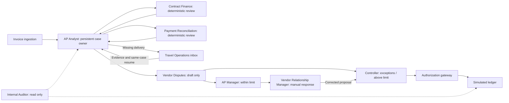

# Finance team implementation

Attest retains the existing contract-to-invoice workflow and adds persisted specialist work, fictional staff identities, a role inbox, deposit reconciliation and dispute preparation. The seven initial invoices are synthetic records. Approval limits are fictional demonstration policy.

## What existed and what changed

Previously implemented: anonymous authenticated private sandboxes; `attest-investigator`; optional CREAO invoice interpretation; deterministic contract calculations; the `human_accountant` and `human_controller` acting roles; versioned proposals; ask/resume and rejection/retry; signed-source guards; an internal idempotent posting gateway; balanced ledger and reversals; append-only application audit events; and a separate CREAO Policy Learner with controller activation and deterministic safety evaluation.

Previously absent: stable fictional employee records, directory, named work ownership, specialist subtask records, role-assigned information requests, bank/AP deposit records, dispute packages and approval thresholds. These are now implemented. Existing identity names and role API literals are retained for compatibility. UI titles map `human_accountant` to Accounts Payable Manager and `human_controller` to Financial Controller.

## Role and permission matrix

| Role / execution | Responsibility and tools | Authority | Boundary |
|---|---|---|---|
| AP Analyst — existing durable orchestrator; CREAO interpretation only in live mode | Own cases; retrieve AP history; assign specialists; assemble deterministic proposals and human requests | Delegate, propose, transition within workflow | Cannot approve, change signed records, transfer funds or bypass gateway |
| Contract Finance — deterministic specialist | Read signed contracts/amendments and applicable active precedents; return governing contract, amendment IDs, effective date, rate cohorts, clauses, conflicts and uncertainties | Contract findings | Cannot modify agreements, approve or post |
| Payment Reconciliation — deterministic specialist | Read seeded bank settlements and AP credits; match vendor, contract, amount, transaction and source references | Payment findings | No payment execution, bank edits, approval or posting |
| Vendor Disputes — deterministic specialist | Assemble evidence-backed draft, amount and required approver; track internal status | Draft dispute | No external sending, vendor acceptance or accounting execution |
| Travel Operations — fictional Avery Chen | Assigned inbox and delivered-room-night evidence | Answer assigned delivery requests | Cannot change contract rates or approve |
| AP Manager — fictional Morgan Ellis | Routine approval inbox; evidence review; reasoned rejection/retry; ingestion and policy proposal | Approve within configured threshold; default $15,000 | Cannot approve corrected payables requiring controller or override posted records |
| Controller — fictional Jordan Reyes | Review exceptions, corrections, authorization settings and policies | Higher-value approval, vendor response recording, signed evidence, reversals, policy activation | Cannot approve their own restricted proposal or alter historical events |
| Vendor Relationship Manager — fictional Samira Patel | Read disputes and record referenced vendor response | Submit manual vendor response text and reference | Cannot approve corrected accounting or send externally |
| Internal Auditor — fictional Taylor Brooks | Read cases, evidence, approvals, policies and audit history | Read only | Mutation attempts explicitly denied and audited |
| Posting Gateway — deterministic internal server capability | Revalidate current proposal, independent approval, evidence, deposit allocation, limit and accounting period | Balanced, idempotent simulated ledger posting | Not a public posting API; no actual bank transfer |
| Policy Learner — existing separate CREAO agent | Propose bounded procedural memory from accepted precedents | Inactive policy proposals | No automatic activation or monetary overrides; see policy-learning.md |

AP Manager limits apply to dispute amount for an unresolved dispute and gross payable for an ordinary payable. Corrected disputed payables always require Controller approval. The gateway rechecks current authority at execution, including policy limit changes after approval.

## Implemented organization

Specialists are durable workflow steps, not separate conversational agents. Contract and payment steps have independent stored assignments and structured outputs. The AP orchestrator uses the same deterministic contract engine as Contract Finance and combines verified payment findings before publishing a proposal. Live CREAO interpretation remains subject to independent deterministic validation. No specialist LLM execution is claimed.

Each subtask retains parent case, revision, attempt, assigned actor, requester, task, evidence IDs, status, structured output/error, completion timestamp and audit reference. Failed and stale executions cannot become completed findings. Human requests remain open until an authorized response; resumption refreshes specialist work under a new revision. Rejection preserves the immutable proposal, records reason and actor, notifies AP in audit history, and waits for a reasoned retry or corrected evidence. Previous approvals cannot approve the revised version.

## Data and migration

New tables: `employees`, `subtasks`, `bankRecords`, `paymentCredits`, `disputes`.

Additive fields: profile `employeeId`; sandbox `teamVersion` and `routineApprovalLimitCents`; case `ownerActorId`; question `assignedActorId`, `requiredRole`, `evidenceKind`, `status`. Source kinds include payment/credit; invoice input can reference a deposit; results separately expose gross, deposit, outstanding invoice balance and supported remaining due.

`workspace.initialize` idempotently provisions staff and approval policy, assigns owners to older cases, binds existing acting roles to stable sandbox-scoped staff IDs, and adds three finance-team scenarios once. It preserves existing cases, proposals, audit records and legacy $750 fixtures. It does not invent historical specialist executions for old cases. Work resumes under new specialist assignments on the next investigation. No reset is required. Existing historical audit actors remain unchanged; new human events use stable staff IDs.

The canonical record uses 50 room-nights at $300 plus 20 additional nights at $250. Gross invoice $21,000; supported gross $20,000; independently verified deposit $3,000; invoiced outstanding $18,000; supported remaining due $17,000; dispute $1,000. These are calculated from structured records, not hardcoded expected outputs. A separate invoice lacks service evidence; another has a deliberately duplicated AP deposit credit and withholds approval-ready amounts.

When posted after vendor resolution and controller approval, the canonical journal debits travel expense $20,000, credits accounts payable $17,000 and clears prepaid deposits $3,000. This is deposit allocation, not a new cash transfer. Repeated posting returns the existing journal.

## Demo path

1. Open **Finance team**. Inspect AP ownership, specialist responsibilities, stable identities and actual assigned cases. Choose the AP Manager or Controller acting role.
2. Open **INV-TEAM-001** in Work queue. Choose **Team handoffs**: Contract Finance returns 50/$300 and 20/$250 cohorts; Payment Reconciliation verifies one $3,000 deposit; Vendor Disputes stores a draft with source IDs. Inspect the calculation and evidence links.
3. Approve the $1,000 dispute as AP Manager. No payable posts and no message sends. To demonstrate escalation, set the manager limit to $500 as Controller; a manager approval attempt is denied and audited. Restore the limit or approve as Controller.
4. Act as Vendor Relationship Manager. Record a manual vendor response and reference confirming $20,000 gross. The same case creates a new proposal. Switch to Controller and approve it. The gateway posts one balanced $20,000/$17,000/$3,000 entry.
5. Open **INV-TEAM-002**. It awaits Travel Operations evidence. Act as Avery Chen via Finance team and open the assigned inbox item. Supply confirmation of 70 room-nights. The same case resumes and recalculates; old proposals and the response remain stored.
6. On a fresh proposed case, reject with a reason. Use Respond & resume with a reasoned retry or revised evidence. Inspect both proposals; only the new proposal may receive fresh approval.
7. Inspect **INV-TEAM-003**: duplicate credit prevents a supported remaining due. Act as Auditor to read sources and history; attempted backend mutations are denied. Use the existing case permission demonstration as Manager/Controller to record the actual agent self-approval denial.
8. Refresh and revisit Finance team and Audit trail. Assignments, staff identities, responses and decision history persist.

## Validation and limits

Automated coverage includes the canonical financial path, scoped original/amendment rates, deposit uniqueness, missing and misapplied payment records, authority limits, specialist failure/staleness, assigned human response/resume, rejection/revision, persistence and idempotent posting. Existing contract ambiguity, blanket discount, CREAO validation/recovery, policy learning and accounting safety suites remain in place.

Authentication isolates each visitor's sandbox. The **acting role selector is explicitly a demo simulation**, not production staff authentication or enterprise RBAC provisioning. A visitor can switch fictional roles within their own sandbox; the model cannot supply an actor ID to grant authority through finance APIs. Production multi-user membership and role administration remain future work.

Bank, AP and source signature flags are synthetic records, not live connector or cryptographic proofs. Vendor responses are manual referenced text, with a legacy Controller-only synthetic confirmation fallback retained for compatibility. No email is sent; no state claims an external send or acknowledgement. Matching uploaded corrected invoice files/credit memos and authenticated vendor portals are not implemented.

The seven connected cases execute real investigation steps when seeded, rather than faking a completed approval feed. Approved/rejected states are created through the demo actions, not predated impersonated employee events. Existing synthetic historical precedents and policy learning are preserved; no new broad organizational-memory engine was added.

Queries are deliberately bounded for the small demo workspace (40 cases, up to 100 subtasks per case). This is not a production-scale archive. Audit records have no client edit/delete API, but are not a cryptographically tamper-evident external audit store.

Core files: `src/lib/finance/organization.ts`, `settlement.ts`, `engine.ts`, `types.ts`; `src/lib/simulation/finance-team.ts`; `convex/team.ts`, `team.test.ts`, `schema.ts`, `validators.ts`, `lib.ts`, `workspace.ts`, `investigations.ts`, `workflows.ts`, `cases.ts`, `policies.ts`; `src/components/finance-team.tsx`, `attest-app.tsx`, `investigation.tsx`; global styles and view types. Existing workflow tests, learning tests and the learning evaluation script gained ingestion-denial guards. Convex API types and the executed Evaluation report are regenerated.

### Executed verification

| Check | Result |
|---|---|
| `npm run typecheck` | Passed |
| `npm run test:report` | 107/107 passed across six test files; Evaluation report regenerated |
| `npm run test:learner` | 6/6 Python tests passed |
| `npm run build` | Passed, including Next.js compilation and TypeScript |
| `git diff --check` | Passed |
| Local `/team` HTTP check | 200 OK |
| Lint | No lint script is configured in this repository |
| Browser interaction / visual QA | Not verified: browser automation surface unavailable in this session |
| New live CREAO end-to-end run | Not executed for this expansion; existing mocked provider validation/recovery tests passed |

Non-blocking existing tooling notices: Vite warns about the future native config loader; Next ignores a parent-directory lockfile outside this repository.
